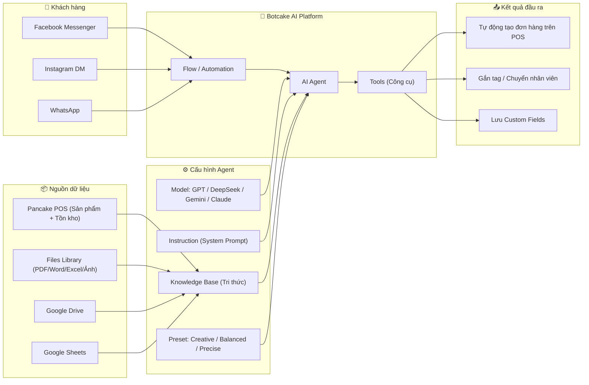
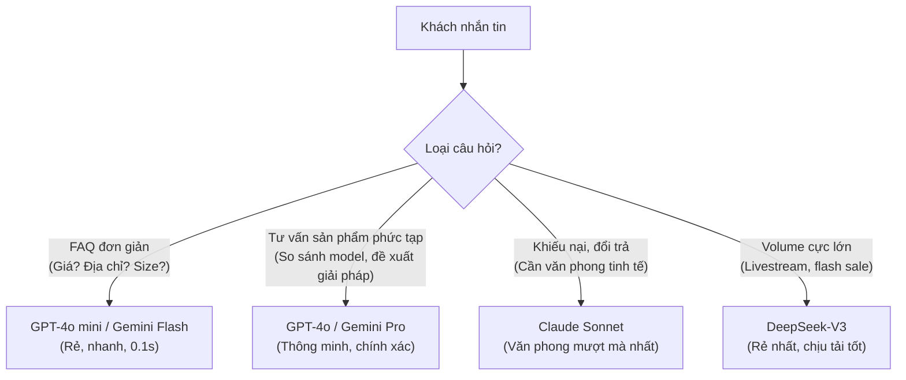
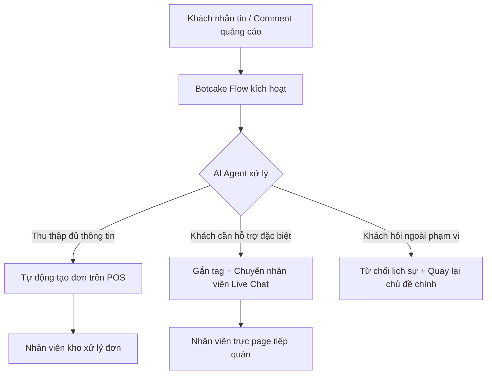
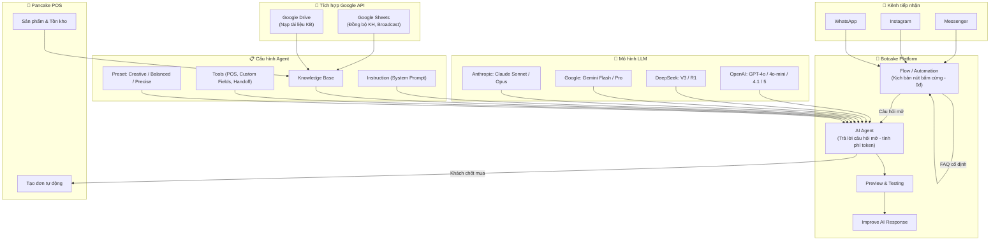

# Tổng kết: Tích hợp Botcake AI – Tài liệu chính thức từ Pancake Docs

> [!NOTE]
> Tổng hợp từ các trang tài liệu chính thức:
> - [Hướng dẫn sử dụng AI](https://docs.pancake.biz/botcake/st-f4/st-p5/st-s1/st-ss1?lang=vi)
> - [8. Tích hợp Botcake AI](https://docs.pancake.biz/docs/botcake/st-f2/st-p10?lang=vi)
> - [Các mô hình LLM đang được tích hợp trên Botcake](https://docs.pancake.biz/botcake/st-f2/st-p10/st-s1?lang=vi)
> - [4. Tích hợp Google API](https://docs.pancake.biz/botcake/st-f2/st-p4?lang=vi)

---

## 1. Kiến trúc tổng thể của Botcake AI



---

## 2. Các mô hình LLM đang được tích hợp trên Botcake

Botcake hỗ trợ **đa mô hình (Multi-model)**, cho phép chọn model phù hợp tùy bài toán:

### 2.1. Bảng tổng quan các model

| Nhà phát triển | Model | Thế mạnh | Khi nào dùng? |
|---|---|---|---|
| **OpenAI** | **GPT-4o mini** | Nhanh, đa phương thức, hiểu ngữ cảnh tốt | FAQ, chào hỏi, tư vấn cơ bản |
| **OpenAI** | **GPT-4o** | Thông minh toàn diện, logic cao, multimodal | Tư vấn phức tạp, chốt đơn giá trị cao |
| **OpenAI** | **GPT-4.1 / GPT-5 series** | Tốc độ siêu việt + tư duy sâu (Reasoning) | Hỗ trợ kỹ thuật chuyên sâu, CSKH cao cấp |
| **DeepSeek** | **DeepSeek-V3** | Suy luận logic, lập trình, toán học | Volume lớn, tiết kiệm chi phí tối đa |
| **DeepSeek** | **DeepSeek-R1** | Reasoning chuyên sâu | Bài toán logic phức tạp |
| **Google** | **Gemini Flash** | Context window cực rộng (1M+ tokens), nhanh | Nạp tài liệu khổng lồ, phản hồi nhanh |
| **Google** | **Gemini Pro** | Đa phương thức, đọc ảnh/tài liệu, tích hợp sâu hệ sinh thái Google | Đọc hiểu tài liệu dài, xử lý ảnh sản phẩm |
| **Anthropic** | **Claude Sonnet** | Văn phong mượt mà nhất, ít hallucination, JSON/Markdown chặt chẽ | Brand voice cao cấp, CSKH tinh tế |
| **Anthropic** | **Claude Opus** | Suy luận sâu nhất dòng Claude, context dài | Tác vụ đòi hỏi tư duy logic phức tạp nhất |

### 2.2. Chiến lược chọn model theo tình huống



### 2.3. Preset (Mức độ sáng tạo)

| Preset | Temperature | Ứng dụng |
|---|---|---|
| **Creative** | Cao | Marketing, Social Media, trả lời sáng tạo linh hoạt |
| **Balanced** | Trung bình | Tư vấn bán hàng (khuyên dùng mặc định) |
| **Precise** | Thấp | Kỹ thuật, bảo hành, báo giá chính xác tuyệt đối |

---

## 3. Quy trình tích hợp 5 bước (theo Docs chính thức)

### Bước 1: Chuẩn bị tài khoản & Nạp tiền ví AI

| Hạng mục | Chi tiết |
|---|---|
| **Ví thanh toán** | Nạp tiền vào ví prepaid trên Botcake. Hệ thống trừ cước theo token thực tế sử dụng |
| **Kết nối kênh** | Facebook Messenger, Instagram DM, WhatsApp |
| **Vào mục** | Trang quản trị Botcake → **Botcake AI** |

### Bước 2: Tạo & Cấu hình Agent AI

#### 2a. Chọn Model & Preset
Chọn model từ bảng tổng quan ở Mục 2 phía trên, kết hợp với Preset phù hợp.

#### 2b. Viết Instruction (System Prompt) – PHẦN QUAN TRỌNG NHẤT

> [!IMPORTANT]
> Đây là phần quyết định AI có bán được hàng hay không. Cấu trúc chuẩn gồm 4 nhóm:

**① Vai trò (Role/Persona):**
```
Bạn là trợ lý tư vấn viên chuyên nghiệp của thương hiệu [Tên công ty].
Xưng hô: Em - Anh/Chị. Giọng điệu: thân thiện, lịch sự, chuyên nghiệp.
```

**② Nhiệm vụ chính (Tasks):**
```
- Tư vấn sản phẩm dựa trên Knowledge Base
- Hướng dẫn chọn model/kích cỡ phù hợp nhu cầu
- Báo giá kèm ưu đãi hiện có
- Thúc đẩy chốt đơn: Thu thập Họ tên, SĐT, Địa chỉ
```

**③ Quy tắc ứng xử (Rules / Guardrails):**
```
- CHỈ trả lời dựa trên thông tin trong Knowledge Base
- TUYỆT ĐỐI không bịa chương trình khuyến mãi hoặc giá bán không có thật
- Không trả lời câu hỏi ngoài phạm vi sản phẩm/dịch vụ
- Khi khách khiếu nại/đổi trả phức tạp → Chuyển giao nhân viên ngay
```

**④ Phong cách giao tiếp (Tone of Voice):**
```
- Thân thiện, lịch sự, gần gũi
- Dùng emoji phù hợp (không lạm dụng)
- Câu trả lời ngắn gọn, đi thẳng vào vấn đề
```

#### 2c. Nạp Knowledge Base (Nguồn tri thức)

| Loại dữ liệu | Cách nạp | Lưu ý |
|---|---|---|
| **Sản phẩm & Tồn kho** | Đồng bộ trực tiếp từ **Pancake POS** | AI đọc giá, tên, tồn kho realtime |
| **Chính sách, FAQ, Bảng thông số** | Upload file PDF / Word / Excel / Ảnh | Dùng cho thông tin ít thay đổi |
| **Tài liệu dung lượng lớn** | Link Google Drive | Tiện cập nhật tập trung |

> [!WARNING]
> **Không dùng file tĩnh (Excel) làm dữ liệu tồn kho** nếu kho biến động liên tục. Thay vào đó, kết nối trực tiếp với Pancake POS để AI luôn có dữ liệu realtime.

### Bước 3: Cấu hình Tools (Công cụ tích hợp)

| Công cụ | Chức năng |
|---|---|
| **Pancake POS** | AI tự động tạo đơn hàng khi khách chốt mua |
| **Custom Fields** | Lưu thông tin khách (tag, sở thích, lịch sử chat) cho automation sau |
| **Human Handoff** | Chuyển giao cuộc hội thoại cho nhân viên trực Live Chat |

**Quy trình chốt đơn tự động:**
```
Khách chốt mua → AI thu thập (Họ tên, SĐT, Địa chỉ, Sản phẩm, Số lượng, Size/Màu)
→ Gửi bảng tổng hợp cho khách xác nhận
→ Tự động đẩy đơn lên Pancake POS
→ Nhân viên kho in mã vận đơn & giao hàng
```

### Bước 4: Kiểm thử (Preview & Testing)

- Sử dụng khung **Xem thử (Preview)** ngay trên giao diện cấu hình Agent
- Thử các kịch bản edge-case:
  - Khách viết tắt, sai chính tả
  - Khách thay đổi ý định mua giữa chừng
  - Hỏi sản phẩm hết hàng
  - Từ chối cung cấp địa chỉ
  - Khiếu nại, đòi gặp nhân viên
- Dùng tính năng **"Cải thiện câu trả lời của AI" (Improve AI Response)** để chỉnh sửa các câu bot trả lời chưa đúng ý

### Bước 5: Đưa Agent vào Flow thực tế & Vận hành



- Vào mục **Flow / Automation** → Thêm khối xử lý bằng AI → Chọn Agent đã cấu hình
- Có thể phân luồng theo **mã quảng cáo (CTM)** hoặc **ID bài viết** để AI tư vấn đúng sản phẩm
- Bật công tắc kích hoạt → Test thực tế trước khi chạy quảng cáo đại trà

---

## 4. Tích hợp Google API (Google Sheets & Google Drive)

> [!NOTE]
> Mục "Tích hợp Google API" trên Botcake **KHÔNG phải** về Google Gemini AI. Nó dùng để kết nối **Google Sheets & Google Drive** phục vụ đồng bộ dữ liệu và gửi tin nhắn hàng loạt.

### 4.1. Các bước kết nối

1. Truy cập **Cấu hình** → **Cấu hình ứng dụng** → **Thêm mới**
2. Chọn **Google Sheets** hoặc **Google Drive** → **Cài đặt** → **Kết nối tài khoản**
3. Chọn tài khoản Gmail chứa các tệp Sheets cần đồng bộ
4. Cấp quyền truy cập → Hiển thị *"Kết nối thành công"*

### 4.2. Ứng dụng thực tế

| Tính năng | Mô tả |
|---|---|
| **Đồng bộ dữ liệu khách hàng** | Tự động cập nhật thông tin khách, Custom Fields từ Botcake/CRM → Google Sheets |
| **Gửi tin nhắn hàng loạt (Broadcast)** | Kích hoạt Flow (Messenger/WhatsApp) cho danh sách khách hàng từ Google Sheets |
| **Nạp Knowledge Base** | Upload tài liệu từ Google Drive vào AI Agent để bot đọc và trích xuất |

### 4.3. Muốn dùng Gemini AI thì làm thế nào?

Gemini **đã có trong danh sách model** của Botcake AI (xem Mục 2). Để sử dụng Gemini:
- **Cách trực tiếp:** Vào Botcake AI → Tạo Agent → Chọn model **Gemini Flash** hoặc **Gemini Pro** từ dropdown
- **Cách gián tiếp (nâng cao):** Kết nối qua **Make.com / Zapier** → Gọi Gemini API riêng → Trả kết quả về Botcake qua Webhook

---

## 5. Tổng kết: Bản đồ toàn bộ hệ sinh thái Botcake AI



