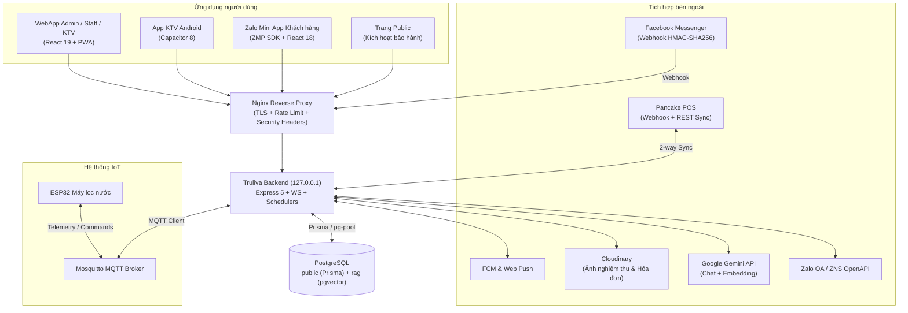

# Truliva — Hệ Thống Quản Trị Dịch Vụ Kỹ Thuật, IoT, AI & Zalo Mini App

[](#)
[](#)
[](#)
[](#)
[](#)
[](LICENSE)

**Truliva** là hệ sinh thái vận hành khép kín (FSM + Mini-ERP + Customer App + IoT + AI Assistant) dành cho doanh nghiệp kinh doanh và cung cấp dịch vụ kỹ thuật máy lọc nước (lắp đặt, thay lõi, bảo hành, sửa chữa). Hệ thống gồm **4 thành phần chính**:

1. **Backend API & Realtime Engine (`src/`)**: Express 5, TypeScript, Prisma 7 (`@prisma/adapter-pg`), WebSocket (`/ws`), Mosquitto MQTT client, đồng bộ 2 chiều Pancake POS, Zalo OA/ZNS, Gemini AI + Hybrid RAG.
2. **WebApp Nội Bộ & App KTV (`webapp/`)**: React 19, Vite 8, Tailwind CSS 3, PWA Web Push và đóng gói Android APK bằng Capacitor 8 (Firebase FCM).
3. **Zalo Mini App Khách Hàng (`zalo-miniapp/`)**: React 18, Vite 5, Tailwind CSS 4, `zmp-sdk` / `zmp-ui` — theo dõi máy IoT, bảo hành điện tử, chia sẻ máy cho người nhà, lịch sử bảo trì và thương mại điện tử.
4. **Firmware & Spec IoT (`IOT/`)**: ESP32 gắn nối tiếp đường truyền dữ liệu bo mạch – màn hình máy lọc nước, gửi telemetry TDS/lưu lượng/tuổi thọ lõi lọc và nhận lệnh điều khiển từ xa qua MQTT.

---

## Mục Lục
- [Kiến Trúc Hệ Thống](#-kiến-trúc-hệ-thống)
- [Các Phân Hệ Nghiệp Vụ Chính](#-các-phân-hệ-nghiệp-vụ-chính)
- [Cấu Trúc Thư Mục](#-cấu-trúc-thư-mục)
- [Cài Đặt & Chạy Local](#-cài-đặt--chạy-local)
- [Quản Lý Ma Trận Phân Quyền](#-quản-lý-ma-trận-phân-quyền)
- [Kiểm Thử & Xác Minh](#-kiểm-thử--xác-minh)
- [Đóng Gói Mobile (Capacitor Android & Zalo Mini App)](#-đóng-gói-mobile-capacitor-android--zalo-mini-app)
- [Triển Khai VPS (Staging-First)](#-triển-khai-vps-staging-first)
- [Bảo Mật & Nguyên Tắc Vận Hành](#-bảo-mật--nguyên-tắc-vận-hành)
- [Tài Liệu Tham Khảo](#-tài-liệu-tham-khảo)

---

## Kiến Trúc Hệ Thống



### Tech Stack
| Tầng | Công nghệ chính |
|---|---|
| **Backend** | Node.js, Express 5, TypeScript 6, Prisma 7 (`@prisma/adapter-pg`), `ws`, `mqtt`, `exceljs`, `winston`, `helmet`, `express-rate-limit` |
| **Database** | PostgreSQL (`public` schema do Prisma quản lý; `rag` schema độc lập chứa `pgvector` HNSW + `tsvector` GIN) |
| **WebApp (`webapp/`)** | React 19, TypeScript, Vite 8, Tailwind CSS 3, React Router 7, Recharts, `react-simple-maps`, `html5-qrcode`, Lucide Icons, Capacitor 8 |
| **Zalo Mini App (`zalo-miniapp/`)** | React 18, Vite 5, Tailwind CSS 4, `zmp-sdk`, `zmp-ui`, `zmp-cli` |
| **Thông báo & Media** | Firebase Admin SDK (FCM), `web-push` (VAPID), Cloudinary, Nodemailer (SMTP) |
| **Vận hành VPS** | Nginx, PM2 + `pm2-logrotate`, Mosquitto MQTT, SFTP deploy (`scripts/vps_deploy.js`) |

---

## Các Phân Hệ Nghiệp Vụ Chính

### 1. Quản Lý Đơn Hàng & Ca Dịch Vụ (`/admin/orders`)
- **Đồng bộ 2 chiều Pancake POS**: Webhook thời gian thực (chống trùng theo `externalEventId` & khóa theo từng đơn), đồng bộ ngược kho xuất hàng và trạng thái (`hoàn thành` / `hủy đơn`) sang POS, kèm scheduler quét bù định kỳ và cơ chế retry có Circuit Breaker.
- **Điều phối đa cấp Trạm – KTV**: Phân bổ theo Trạm chính → Trạm kỹ thuật → KTV, gợi ý KTV, hỗ trợ phân bổ/hủy hàng loạt, quản lý gói Combo linh hoạt (`ProductCombo`) và lưu vết đầy đủ trong `AuditLog`.
- **Cập nhật Real-time**: WebSocket (`/ws`, yêu cầu xác thực session) đẩy thay đổi tức thì không cần tải lại trang.
- **Hướng dẫn sử dụng tích hợp (`WebGuideTour`)**: Spotlight chuẩn Enterprise lọc tự động theo Ma trận phân quyền và hiển thị quy trình thao tác (SOP) cho từng nút chức năng.

### 2. Quản Lý Yêu Cầu Hotline & Lịch Sử Khách Hàng (`/admin/hotlines`)
- **Luồng 2 pha (Phase 2 → Phase 3)**: Tiếp nhận yêu cầu từ khách hàng/Sale → Hotline/Điều phối xác thực, tư vấn (có lịch sử ghi chú & phản hồi), theo dõi SLA và chuyển đổi thẳng thành Ca dịch vụ.
- **Tra cứu Lịch sử Khách hàng 360°**: Tổng hợp Hồ sơ KH, Thiết bị/Serial sở hữu (hiển thị đầy đủ địa chỉ), Đơn dịch vụ hiện tại, Phiếu Hotline và **~162.000 bản ghi Lịch sử dịch vụ cũ (`LegacyServiceHistory`)** từ hệ thống cũ (12/2016 – 10/2026, tách biệt hoàn toàn khỏi `orders`).
- **Nhập thủ công lịch sử khách hàng**: Cho phép nhóm được cấp quyền (Admin, Điều phối viên, Sales, Hotline) bổ sung bản ghi lịch sử trực tiếp vào mục Tra cứu (kèm validate chặt, rate limit theo user và ghi `AuditLog`).

### 3. Báo Cáo Kỹ Thuật, Lương KTV & Hoa Hồng (`/ktv/*`, `/admin/reports`, `/admin/salaries`)
- **Ứng dụng KTV (PWA & Android APK)**: Nhận thông báo đẩy khi có ca mới, xem tồn kho cá nhân, nộp báo cáo nghiệm thu (ảnh mẫu theo từng loại công việc, serial, TDS vào/ra, áp suất nước, linh kiện, tiền thu thực tế).
- **Bảo tồn vĩnh viễn chứng từ**: Mọi `ServiceReport` được lưu trữ vĩnh viễn theo chính sách Zero Hard-Delete.
- **Bảng lương & Hoa hồng theo tháng**: Hỗ trợ đơn giá riêng theo KTV (`KtvServiceRate`), điều chỉnh thủ công có ghi chú, chốt/khóa kỳ lương (`DRAFT`/`FINAL`), xuất Excel chi tiết và áp dụng cô lập tháng nghiêm ngặt từ 11/2026 (`isStrictMonth`).

### 4. Quản Lý Serial, Bảo Hành Điện Tử & Zalo ZNS (`/admin/serials`, `/warranty-activate`)
- Quản lý vòng đời Serial, chính sách bảo hành theo dòng máy (`WarrantyPolicy`), mã khuyến mãi cộng thêm tháng bảo hành (`WarrantyPromo`) và import/export Excel.
- **Kích hoạt bảo hành công khai (`/warranty-activate`)**: Khách hàng tự kích hoạt kèm kiểm tra ảnh hóa đơn Cloudinary hợp lệ, chuẩn SĐT 10 số, giới hạn 3 lần/24h mỗi SĐT và tự động gửi tin nhắn Zalo ZNS (`ZnsMessageLog`).

### 5. Giám Sát Thiết Bị IoT — ESP32 / MQTT (`/admin/iot`)
- Nhận telemetry thời gian thực (TDS vào/ra, lưu lượng, tổng lít nước, áp suất, trạng thái bơm, tuổi thọ lõi lọc) qua Mosquitto MQTT → lưu `iot_devices`, `iot_telemetry`, `iot_alerts`.
- Nhận diện dòng máy tập trung qua `resolveIotModel()` (`src/config/waterPurifiers.ts`), cảnh báo có cooldown và xử lý tuần tự theo serial.
- Điều khiển từ xa có xác thực lệnh (`ping`, `reboot`, `set_interval`, `ota`) và đối chiếu hiệu lực qua telemetry trả về.

### 6. Trợ Lý AI, Hybrid RAG & Facebook Messenger Bot (`/admin/ai-assistant`)
- Cấu hình giọng điệu, system prompt, FAQ và quản lý phiên chat / theo dõi lượng token (`AiBotConfig`, `AiChatSession`, `AiChatMessage`).
- **Hybrid RAG**: Kết hợp tìm kiếm vector (`pgvector` HNSW, 768 chiều) và full-text (`tsvector` GIN) nằm ở schema `rag` tách riêng khỏi Prisma để tránh bị `prisma db push` xóa nhầm.
- **Facebook Messenger Bot**: Tích hợp webhook xác thực chữ ký `X-Hub-Signature-256` (HMAC-SHA256 raw body), gom tin nhắn 5 giây và phản hồi bằng Gemini + RAG.

### 7. Zalo Mini App Khách Hàng (`zalo-miniapp/`)
- Theo dõi tình trạng nước & tuổi thọ lõi lọc IoT trực tiếp, cài đặt lại Wi-Fi, chia sẻ quyền xem máy cho người nhà (`SerialMember`).
- Tra cứu bảo hành, lịch sử bảo trì/thay lõi, gửi yêu cầu hỗ trợ kỹ thuật, hạng thành viên/voucher và hướng dẫn sử dụng tương tác (`GuideTour` + linh vật Livy).
- Gian hàng E-Commerce (`ShopProduct`, `ShopOrder`) tích hợp bộ 8 văn bản pháp lý TMĐT (`LegalDocument`) và lưu vết chấp thuận của khách hàng (`CustomerConsent`).

### 8. Ma Trận Phân Quyền Động 3 Tầng (`/admin/users`)
- Hỗ trợ 8 vai trò (`ADMIN`, `DEV`, `COORDINATOR`, `HOTLINE`, `SALE_SUPERVISOR`, `SALER`, `STAFF`, `KTV`) và phân quyền 3 tầng ưu tiên: **User-Level Override → Group-Level Matrix → Role-Level Matrix**.

---

## Cấu Trúc Thư Mục

```text
Truliva/
├── src/                        # Backend Express 5 + TypeScript
│   ├── config/                 # database.ts, pancake.ts, permissions.ts (SSOT), waterPurifiers.ts
│   ├── controllers/            # order, report, salary, serial, hotline, shop
│   ├── middleware/             # authSession.ts (JWT/RBAC), auth.ts (Webhook), rateLimiter.ts, security.ts
│   ├── routes/                 # 22 routers gắn tại /api/* và /webhooks/*
│   ├── services/               # Pancake sync, MQTT IoT, WebSocket, ZNS, RAG/AI, Salary, Commission, PermissionSync
│   ├── utils/                  # logger.ts, provinces.ts, emailService.ts, sandboxGuard.ts
│   └── index.ts                # Entry point & background schedulers
├── prisma/
│   └── schema.prisma           # Toàn bộ models PostgreSQL (đồng bộ qua `prisma db push`)
├── webapp/                     # WebApp Admin / Staff / KTV (React 19 + Vite 8 + Capacitor 8)
│   └── src/
│       ├── api/                # client.ts (fetchApi, upload, orders)
│       ├── components/         # Layout, WebGuideTour, PermissionMatrix, hotline/*, selectors...
│       ├── config/             # permissions.ts (auto-generated), webGuideTopics.ts
│       ├── context/            # AuthContext, PermissionContext, ConfirmContext
│       └── pages/              # admin/*, ktv/*, dev/*, public/*
├── zalo-miniapp/               # Zalo Mini App khách hàng (React 18 + ZMP SDK)
│   └── src/
│       ├── components/         # IotDeviceCard, DeviceSharingPanel, GuideTour, BottomNavBar...
│       ├── config/             # features.ts, guideTopics.ts
│       └── pages/customer/     # CustomerHome, ProductCatalog, Cart, Checkout, MyOrders, Profile
├── scripts/                    # Công cụ vận hành, deploy SFTP, backup/restore, audit & verify_*.js
├── IOT/                        # Firmware ESP32 & tài liệu giải mã giao thức máy lọc nước
├── docs/                       # Tài liệu kỹ thuật (IoT partner integration...)
└── .env.example                # Mẫu biến môi trường (không commit .env thật)
```

---

## Cài Đặt & Chạy Local

### Yêu cầu hệ thống
- **Node.js**: v20.x trở lên (khuyến nghị LTS).
- **PostgreSQL**: Khuyến nghị có extension `pgvector` nếu chạy tính năng RAG cục bộ.

### 1. Cài đặt phụ thuộc
```bash
# Backend (thư mục gốc)
npm install

# WebApp (bắt buộc --legacy-peer-deps do react-simple-maps khai báo peer React <= 18)
cd webapp
npm install --legacy-peer-deps
cd ..

# Zalo Mini App (nếu phát triển Mini App)
cd zalo-miniapp
npm install
cd ..
```

> Lưu ý: Giữ `prisma`, `@prisma/client` và `@prisma/adapter-pg` ở **cùng phiên bản** (hiện tại `7.8.0`).

### 2. Cấu hình biến môi trường
Sao chép `.env.example` thành `.env` tại thư mục gốc và điền các giá trị tương ứng (Database, `JWT_SECRET`, `ZALO_MINIAPP_JWT_SECRET`, Pancake POS, Cloudinary, SMTP, VAPID, Firebase, MQTT, Gemini AI, Facebook Webhook, SSH VPS).

### 3. Sinh Prisma Client & Chạy môi trường Dev
```bash
# Sinh Prisma Client cho TypeScript
npx prisma generate

# Đồng bộ danh mục phân quyền Frontend + chạy song song Backend (:3000) & WebApp (:5173)
npm run dev
```

### 4. Lệnh kiểm tra nhanh (Typecheck & Lint)
```bash
# Typecheck Backend
npx tsc --noEmit

# Typecheck & Lint WebApp
cd webapp && npx tsc --noEmit -p tsconfig.app.json && npm run lint

# Mở Prisma Studio kết nối DB trên VPS qua SSH Tunnel
npm run studio           # Production (cẩn trọng)
npm run studio:sandbox   # Sandbox
```

---

## Quản Lý Ma Trận Phân Quyền

Nguồn định nghĩa duy nhất (Single Source of Truth) nằm tại `src/config/permissions.ts` (`SYSTEM_FEATURES`). File `webapp/src/config/permissions.ts` được **sinh tự động**, không sửa tay.

```bash
# Sinh lại file quyền cho Frontend sau khi sửa src/config/permissions.ts
npm run perm:gen

# Kiểm tra đồng bộ giữa Backend và Frontend
npm run perm:check

# Kiểm toán toàn bộ key phân quyền (Backend routes + Frontend hasPermission)
npm run audit:permissions
```

Khi backend khởi động, `syncPermissionCatalog()` tự động bổ sung các key mới vào DB (non-destructive, không ghi đè cấu hình cũ) và gắn huy hiệu **MỚI** để Admin duyệt trên giao diện Ma trận phân quyền.

---

## Kiểm Thử & Xác Minh

Hệ thống sử dụng bộ script kiểm thử tích hợp chạy trực tiếp vào API thật tại `scripts/verify_*.js`:

| Script | Mục đích | Môi trường |
|---|---|---|
| `scripts/verify_prod_hardening.js` | Kiểm tra cấu hình bảo mật production (cookies, headers, CORS, Host) | Chỉ đọc (Sandbox/Prod) |
| `scripts/verify_login_hardening.js` | Kiểm tra đăng nhập, chống dò username, khóa tạm tài khoản | Sandbox/Prod |
| `scripts/verify_ws_and_public_auth.js` | Kiểm tra xác thực WebSocket `/ws`, OAuth state và endpoint public | Chỉ đọc (Sandbox/Prod) |
| `scripts/verify_facebook_webhook_signature.js` | Kiểm tra xác thực chữ ký HMAC-SHA256 Facebook Webhook | Chỉ đọc (Sandbox/Prod) |
| `scripts/verify_legacy_history_api.js` | Kiểm tra tra cứu lịch sử dịch vụ cũ & chặn `CUSTOMER` | Chỉ đọc (Sandbox/Prod) |
| `scripts/verify_legacy_history_create.js` | Kiểm thử bảo mật & ghi dữ liệu nhập tay lịch sử KH (22 test cases) | **Chỉ Sandbox** |
| `scripts/verify_public_activation.js` | Kiểm thử kích hoạt bảo hành công khai & chặn ảnh hóa đơn giả | **Chỉ Sandbox** |
| `scripts/verify_iot_api.js` / `verify_miniapp_iot.js` | Kiểm tra API IoT & hiển thị Mini App | Chỉ đọc (thêm `--write` trên Sandbox) |
| `scripts/verify_rag_api.js` | Kiểm tra truy vấn Hybrid RAG | Chỉ đọc (Sandbox/Prod) |
| `scripts/verify_salary_month_isolation.js` | Kiểm tra cô lập số liệu bảng lương theo tháng | Chỉ đọc (Sandbox/Prod) |

---

## Đóng Gói Mobile (Capacitor Android & Zalo Mini App)

### 1. Android APK cho KTV (`webapp/`)
```bash
cd webapp
npm run build
npx cap sync android
cd android
.\gradlew.bat assembleDebug
```
File APK được xuất tại `webapp/android/app/build/outputs/apk/debug/app-debug.apk`.

### 2. Zalo Mini App (`zalo-miniapp/`)
```bash
cd zalo-miniapp
# Build kiểm thử cục bộ
npx vite build --outDir dist_check

# Phát hành lên Zalo Mini App Studio (yêu cầu đăng nhập zmp-cli)
npm run deploy
```

---

## Triển Khai VPS (Staging-First)

Hệ thống chạy 2 môi trường độc lập trên VPS thông qua **PM2** và **Nginx**:

| Môi trường | Thư mục VPS | PM2 Process | Port (loopback) | PostgreSQL DB |
|---|---|---|---|---|
| **Sandbox** | `/var/www/truliva-sandbox` | `truliva-sandbox` | `3001` (`:8443` HTTPS) | `truliva_sandbox` |
| **Production** | `/var/www/truliva` | `truliva-backend` | `3000` (`:443` HTTPS) | `truliva_db` |

### Quy trình chuẩn (Bắt buộc Sandbox trước → Production sau)
```bash
# 1. Tải bản đang chạy trên VPS về để diff với git HEAD (VPS không dùng git pull)
node scripts/vps_deploy.js pull sandbox <outDir> <file...>

# 2. Upload file nguồn (tự động backup bản cũ vào backups/deploy_<timestamp>/)
node scripts/vps_deploy.js push sandbox <file...>

# 3. Biên dịch trực tiếp trên VPS (cấm upload file dist/*.js từ local)
node scripts/vps_deploy.js exec sandbox -- "npx tsc && cd webapp && npm run build && cd .. && pm2 restart truliva-sandbox --update-env"

# 4. Chạy script nghiệm thu HTTP thực tế trên Sandbox trước khi lặp lại cho Production
node scripts/vps_deploy.js exec sandbox -- "pm2 status && node scripts/verify_<module>.js"
```

> **Lưu ý về Database Schema**: Dự án đồng bộ schema bằng `npx prisma db push && npx prisma generate` trực tiếp trên VPS (không dùng `prisma migrate dev`). Luôn kiểm tra `npx prisma migrate diff` trước khi push để đảm bảo không phát sinh lệnh `DROP`.

---

## Bảo Mật & Nguyên Tắc Vận Hành

1. **Zero Hard-Delete Policy**: Tuyệt đối không xóa vật lý dữ liệu (`delete`, `deleteMany`, `DELETE FROM`, `TRUNCATE`). Đơn hàng hủy chuyển `adminStatus = 'hủy đơn'` kèm `cancelReason` và `AuditLog`; các thực thể khác dùng soft-delete (`isActive = false` / `isArchived = true`); `ServiceReport` được bảo tồn vĩnh viễn.
2. **Defense-in-Depth**:
   - Backend chỉ lắng nghe trên `127.0.0.1` phía sau Nginx; kiểm tra `Host`, CORS theo allowlist, Helmet và chặn bot/honeypot.
   - Tách biệt hoàn toàn JWT nội bộ (`JWT_SECRET`, có `tokenVersion` thu hồi phiên) và JWT khách hàng Mini App (`ZALO_MINIAPP_JWT_SECRET`, bị chặn cứng 403 trên mọi route nội bộ).
   - Áp dụng Rate Limiting theo IP và theo tài khoản cho đăng nhập, quên mật khẩu, kích hoạt bảo hành công khai và nhập lịch sử thủ công.
3. **Cảnh báo IoT Sandbox**: Sandbox và Production dùng **chung broker Mosquitto MQTT và thiết bị thật** — không gửi lệnh tác động (`reboot`, `set_interval`, `ota`) lên máy khách hàng khi chưa có xác nhận.

---

## Tài Liệu Tham Khảo

| Tài liệu | Nội dung |
|---|---|
| [API.md](API.md) | Tài liệu chi tiết các endpoint API, phân quyền và payload |
| [DEPLOY_AND_TESTING_RULES.md](DEPLOY_AND_TESTING_RULES.md) | Quy chuẩn deploy VPS và kiểm thử nghiệm thu HTTP bắt buộc |
| [UI_DESIGN_SYSTEM.md](UI_DESIGN_SYSTEM.md) | Quy chuẩn thiết kế giao diện (màu sắc, badges, bo góc, mobile UX) |
| [INVENTORY_FLOW.md](INVENTORY_FLOW.md) | Luồng quản lý kho và đồng bộ tồn kho Pancake POS |
| [ESP32_MQTT_Integration_Spec.md](ESP32_MQTT_Integration_Spec.md) | Đặc tả giao thức tích hợp ESP32 & MQTT |
| [docs/IOT_PARTNER_INTEGRATION_GUIDE.md](docs/IOT_PARTNER_INTEGRATION_GUIDE.md) | Hướng dẫn tích hợp IoT dành cho đối tác |
| [SECURITY_AUDIT_REPORT.md](SECURITY_AUDIT_REPORT.md) | Báo cáo rà soát và hardening bảo mật hệ thống |
| [.env.example](.env.example) | Mẫu cấu hình biến môi trường |
